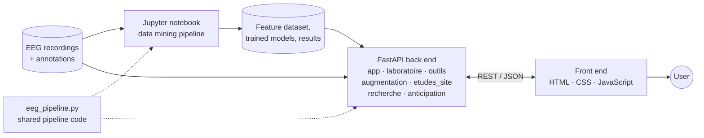
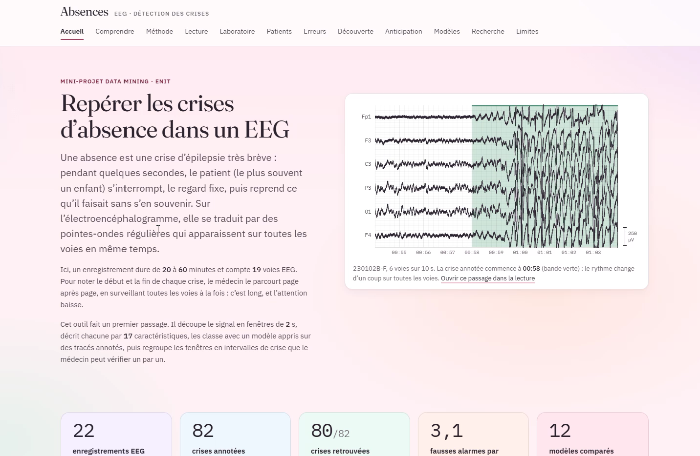
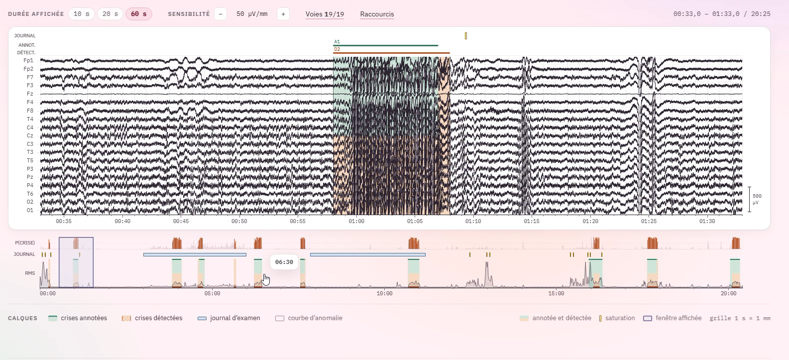
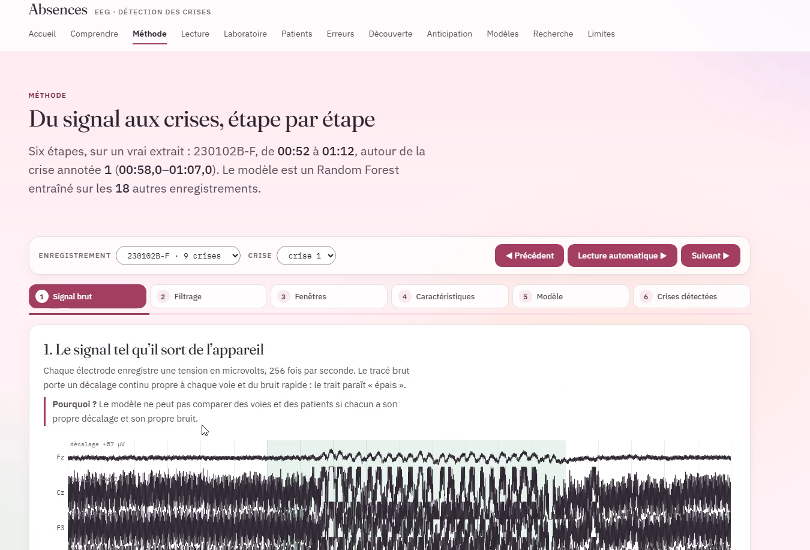
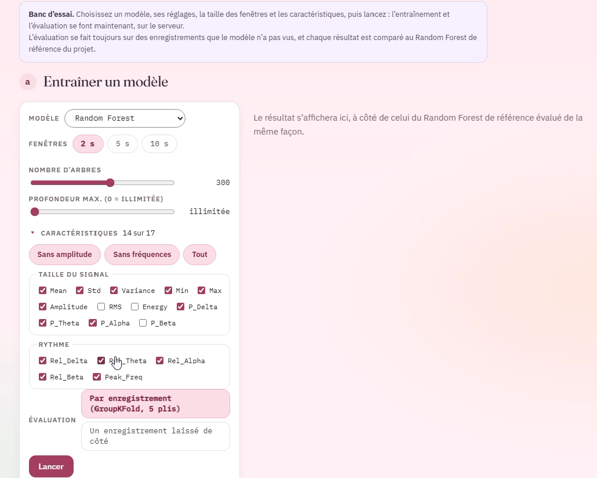
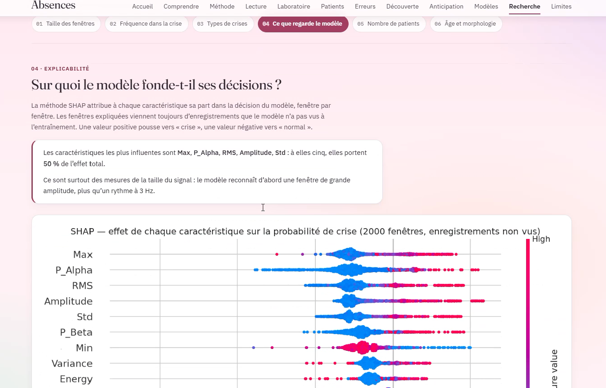

# EEG Absence-Seizure Detection

A data mining pipeline and a full-stack web application for detecting absence seizures in clinical EEG.


## Overview

Absence seizures are short and easy to miss, and finding them means a neurologist has to read hours of multichannel EEG. This project turns raw clinical recordings into a list of seizure intervals with start and end times, ready for review. It does this by segmenting the signal, describing each segment with features, classifying the segments and merging the positive ones back into events. The work is delivered twice: as a research notebook, and as a web application that runs the same pipeline on real recordings.

Data Mining course project, National Engineering School of Tunis (ENIT), 2026–2027.

## Medical context

An electroencephalogram (EEG) records the brain's electrical activity through electrodes placed on the scalp according to the international 10-20 system. An absence seizure is a brief, generalized seizure: the patient, usually a child, stops responding and stares, then resumes without any memory of it. On the EEG it shows as regular, slow spike-and-wave discharges that appear on all channels at once. Reviewing long recordings channel by channel is slow, and short events are easy to overlook.

## Data mining approach

- **Data understanding and cleaning:** decoding of the MATLAB recordings, and conversion and sanity checks of the expert annotations (duplicates, implausible durations, events outside the recording).
- **Preprocessing:** offset removal and zero-phase band-pass filtering of each EEG channel.
- **Segmentation:** overlapping fixed-length windows, each labelled from the annotations.
- **Feature engineering:** time-domain amplitude and energy measures, plus spectral band powers and the dominant frequency. These capture the high-amplitude, rhythmic signature of spike-and-wave discharges.
- **Class imbalance:** class weighting, a stratified split, and metrics that focus on the seizure class rather than accuracy.
- **Model comparison:** decision trees, random forests, extra trees, gradient boosting (XGBoost, LightGBM, HistGradientBoosting), k-nearest neighbours, SVM, logistic regression, naive Bayes and a neural network (MLP).
- **Recording-wise validation:** windows from the same recording overlap and look alike. Testing only on recordings never seen in training prevents data leakage and gives an honest estimate for a new patient.
- **Post-processing:** window predictions are smoothed and merged into seizure intervals, which are then matched against the annotations.
- **Interpretability and exploratory studies:**
  - SHAP explanations of the model's decisions
  - clustering of seizure types
  - seizure anticipation
  - an autoencoder that flags unannotated discharges
  - robustness to failing electrodes

Detailed methodology and results: [docs/METHODOLOGY.md](docs/METHODOLOGY.md)

## Web application

Every recording shown in the application is analysed by a model that was trained without it.

**Explore**
- Browse the recording catalogue and read the multichannel EEG in a clinical-style viewer. Time span, sensitivity and channel selection are adjustable.
- Overlay annotated seizures, detected seizures, exam events (hyperventilation, photic stimulation, amplifier saturations) and an anomaly curve.
- Every page and every position in a trace has its own shareable URL.
- Import a new recording file, and switch the analysis window length on any recording.

**Understand**
- An introduction to absences with a real annotated excerpt.
- A side-by-side comparison of normal and seizure EEG, with an interactive electrode map.
- A guided, step-by-step walkthrough of the method on a real signal: raw signal, filtering, windows, features, model, detected seizures.

**Detect and review**
- Run detection on any recording and compare the detected intervals with the expert annotations, onset delay included.
- Review every missed seizure and false alarm with its EEG excerpt and exam context.
- Export detected intervals and errors as CSV.
- Patients page:
  - map of the recordings and k-means grouping;
  - filters and two-group comparison;
  - re-run detection on a selection;
  - find similar recordings.

**Lab**
- **Real time:** replay a recording at adjustable speed, with live window-by-window detection, an alarm, and agreement with the offline analysis.
- **Settings:** tune the decision threshold, smoothing, merge gap and minimum duration, and switch between two models. Results update immediately in the browser.
- **Stress tests:**
  - inject artefacts (movement, muscle, mains noise, electrode detachment, eye blink);
  - inject synthetic spike-and-wave discharges;
  - map detection over frequency and amplitude.
- **Electrodes and augmentation:** remove or corrupt electrodes, change the reference, or retrain with augmented data, and compare before and after.

**Model bench**
- Compare all classifiers under a random split and under recording-wise validation.
- Train a model with chosen hyperparameters, window length, feature subset and validation scheme. Each run is compared with the reference model, and recent runs are kept in a history.
- Test a configuration on one recording, or run a duel between two configurations and inspect where they disagree.

**Research**
- Notebook findings: window length, frequency evolution within seizures, seizure types, SHAP, learning curve, age and discharge morphology.
- Seizure anticipation results.
- A review page for the autoencoder's candidate discharges, where a reviewer can record an opinion on each one.
- A limitations page with live demonstrations of each limitation.

## Architecture



- **Shared pipeline code:** loading, filtering, feature extraction and detection live in one module, `eeg_pipeline.py`. The notebook and the application therefore produce the same results.
- **Modular back end:** each area of the application (lab, model bench, studies, research results) is a separate FastAPI router.
- **REST API:** the front end gets everything as JSON (recordings, signal slices, detections, jobs), so the interface and the computations stay independent.
- **Background jobs and caching:** long computations run as background jobs with progress tracking and cancellation. Results are cached according to their parameters, so repeating a run is instant.
- **Framework-free front end:** plain HTML, CSS and JavaScript with hash-based routing. There is no build step and no JavaScript library.

| Data & ML | Back end | Front end | Tooling |
|---|---|---|---|
| NumPy, SciPy, pandas, scikit-learn, XGBoost, LightGBM, SHAP, PyTorch | Python, FastAPI, Uvicorn, Pydantic, joblib | HTML, CSS, JavaScript | Jupyter, Google Colab, Matplotlib, seaborn, Git |

```
.
├── EEG_Absence_Detection.ipynb   Research notebook: full data mining pipeline and analyses
├── notebooks/                    Google Colab version of the notebook
├── eeg_pipeline.py               Pipeline shared by the notebook and the application
├── app.py                        FastAPI application: catalogue, viewer, detection, API
├── laboratoire.py                Real-time replay, threshold settings, stress tests
├── outils.py                     Model bench, patient tools, limitation demos
├── augmentation.py               Data augmentation and retraining
├── etude_*.py, etudes_site.py    Autoencoder and electrode-robustness studies
├── recherche.py, anticipation.py Research results served to the application
├── static/                       Front end (HTML, CSS, JavaScript)
├── docs/                         Methodology and screenshots
└── requirements.txt              Python dependencies
```

## Screenshots

<table>
  <tr>
    <td width="50%"><br><sub>Home page with an annotated absence on the EEG.</sub></td>
    <td width="50%"><br><sub>Multichannel viewer with annotated and detected seizures.</sub></td>
  </tr>
  <tr>
    <td><br><sub>Step-by-step walkthrough of the method on real signal.</sub></td>
    <td><br><sub>Real-time replay with live detection.</sub></td>
  </tr>
  <tr>
    <td><br><sub>Model bench: configure, train and evaluate a model.</sub></td>
    <td><br><sub>SHAP analysis of what drives the model's decisions.</sub></td>
  </tr>
</table>

[More screenshots](docs/screenshots/more/)

## Getting started

**Prerequisites:** Python 3.10 or newer, and the course dataset. The dataset was provided for the course and is not distributed with this repository.

```bash
git clone https://github.com/chaimaelakremi/DataMining.git
cd DataMining
python -m venv .venv
source .venv/bin/activate        # Windows: .venv\Scripts\activate
pip install -r requirements.txt
```

1. Place the recordings (`*_0000d.mat`, plus the optional `*_0000h.mat` exam logs) and the annotation spreadsheet in `data/`.
2. Run `EEG_Absence_Detection.ipynb`. The application reads its outputs from `resultats/`, so set `DM_OUT=resultats` or copy them there. See [docs/METHODOLOGY.md](docs/METHODOLOGY.md#run).
3. Start the application with `uvicorn app:app --port 8000`, then open <http://localhost:8000>.

## Author

**Chaima Elakremi**, Computer Science Engineering student, ENIT
[LinkedIn](https://www.linkedin.com/in/chaima-elakremi-748004332/) · [GitHub](https://github.com/chaimaelakremi)

## License

© 2026 Chaima Elakremi. All rights reserved. See [LICENSE](LICENSE).
