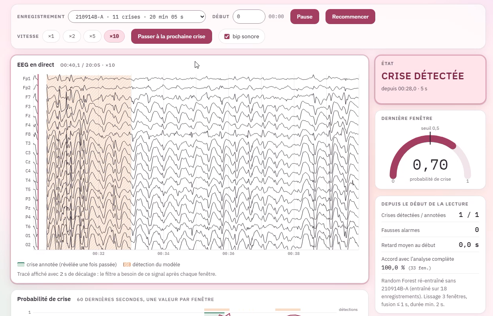
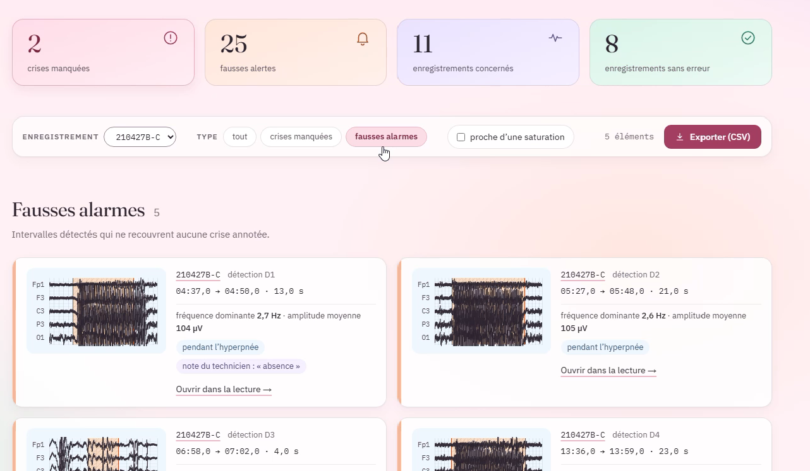
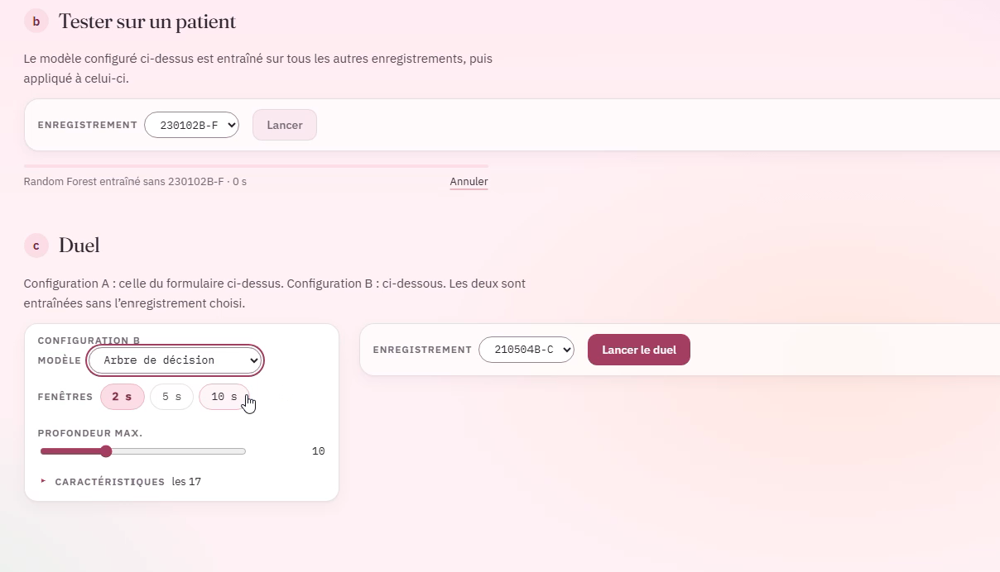
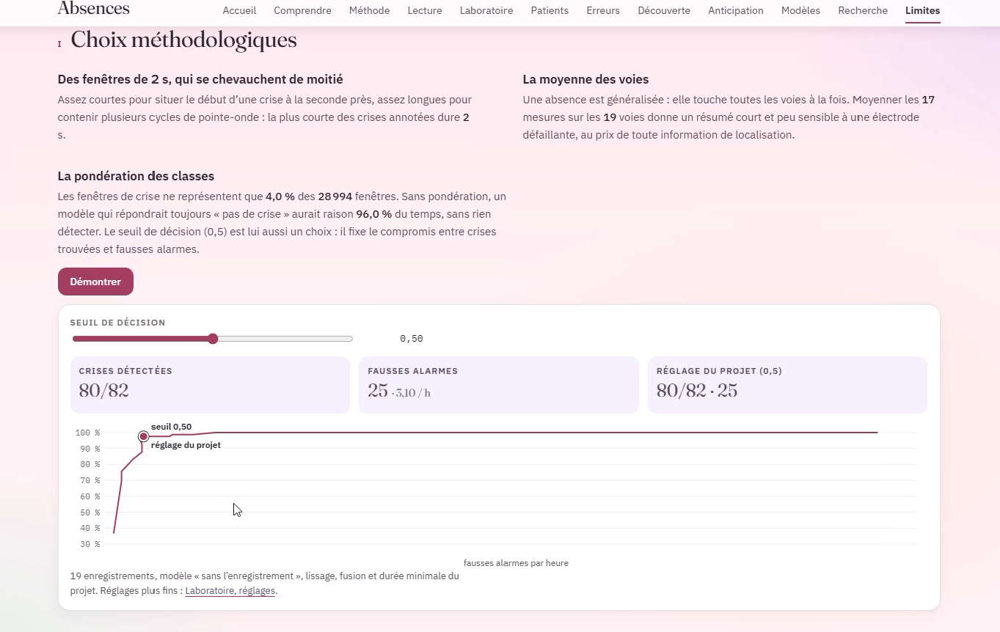
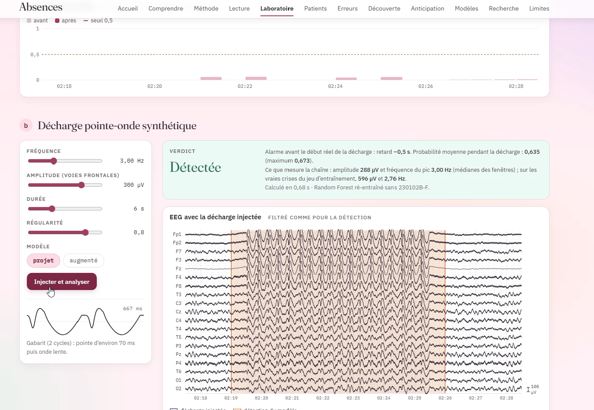
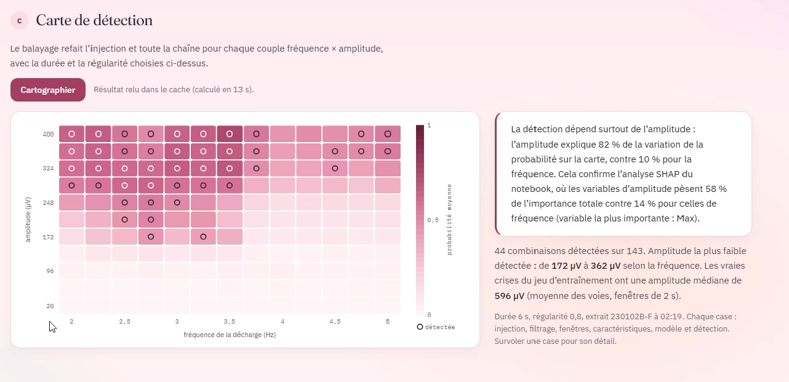
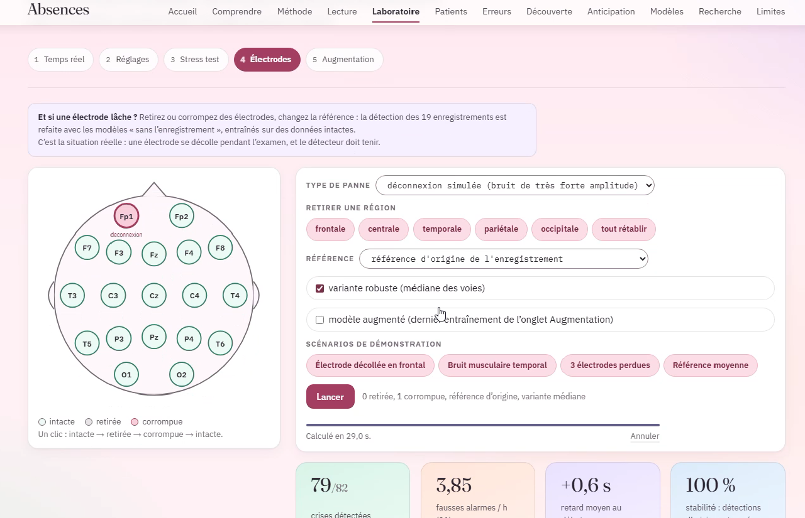

# Absences: EEG Absence-Seizure Detection

> Automatically finding absence seizures in 19-channel EEG recordings, from raw signal to a list of seizure intervals, with an interactive web app to explore the results.

## Context

Data Mining course project at **ENIT** (École Nationale d'Ingénieurs de Tunis), academic year 2025–2026.

## Problem

An absence seizure is a very short epileptic seizure (a few seconds) during which the patient, usually a child, stops responding and stares blankly. On the EEG it shows up as a regular ~3 Hz spike-and-wave discharge on all channels at once. To annotate a recording (20 to 60 minutes, 19 channels), a neurologist has to scroll through it page by page. That takes a long time and attention drops.

The goal is a first-pass detector that turns the raw EEG into a list of candidate seizures (start and end) for the doctor to check.

## Pipeline

1. **Loading**: MATLAB `.mat` timetables (19 EEG channels, 256 Hz) and seizure annotations from an Excel file. Seizures longer than 120 s or outside the recording are discarded.
2. **Preprocessing**: per-channel median offset removal, then a 4th-order Butterworth band-pass filter (0.5–40 Hz, zero-phase).
3. **Segmentation**: 2 s windows with 50 % overlap. A window is labelled *seizure* if at least half of it lies inside an annotated seizure.
4. **Features (17 per window, averaged over the 19 channels)**:
   - time domain: Mean, Std, Variance, Min, Max, Amplitude, RMS, Energy
   - frequency domain: absolute and relative power in the Delta, Theta, Alpha and Beta bands, plus the dominant frequency (Peak_Freq)
5. **Classification** of each window.
6. **Temporal detection**: 3-window median smoothing, detections less than 1 s apart are merged, and events shorter than 2 s are dropped. Each detected interval is matched against the annotated seizures.

The final dataset has **28,994 windows**, of which **1,174 (4.05 %)** are seizure windows. The data comes from 19 annotated recordings with 82 seizures.

## Models

- **Main comparison**: Decision Tree, Random Forest, KNN and SVM (each with a `StandardScaler`, and class weighting where available).
- **Extended comparison**: Extra Trees, XGBoost, LightGBM, MLP, HistGradientBoosting, Gaussian Naive Bayes, Logistic Regression, plus a dummy "always no seizure" baseline.

Evaluation uses three protocols:

- a stratified random 80/20 split
- `GroupKFold` by recording (5 folds), which is more realistic because the model never sees the test recording
- a model retrained without each recording for seizure-level detection

## Results

All numbers below come from the executed notebook `EEG_Absence_Detection.ipynb`.

**Window level: random 80/20 split**

| Model | Accuracy | Precision | Recall | F1 |
|---|---|---|---|---|
| **Random Forest** | 0.983 | 0.830 | 0.728 | **0.776** |
| KNN | 0.979 | 0.792 | 0.647 | 0.712 |
| SVM | 0.951 | 0.445 | 0.877 | 0.590 |
| Decision Tree | 0.946 | 0.416 | 0.817 | 0.551 |
| Dummy (always "no seizure") | 0.959 | 0 | 0 | 0 |

**Window level: recordings never seen during training** (`GroupKFold`, 5 folds)

| Model | Precision | Recall | F1 |
|---|---|---|---|
| Extra Trees | 0.715 | 0.743 | 0.729 |
| Random Forest | 0.743 | 0.665 | 0.702 |
| LightGBM | 0.671 | 0.733 | 0.701 |
| XGBoost | 0.654 | 0.751 | 0.699 |

**Seizure level** (each recording analysed by a model trained without it)

| Model | Seizures detected | False alarms |
|---|---|---|
| **Random Forest** | **80 / 82 (97.6 %)** | 25 (3.1 per hour) |
| Extra Trees | 81 / 82 (98.8 %) | 41 (5.1 per hour) |

Random Forest misses only 2 seizures, both in the one adult recording. Accuracy is misleading here: a model that never predicts a seizure already reaches 95.9 %, so the analysis relies on F1 and seizure-level sensitivity.

**Further analyses** in the notebook:

- window size (2 / 5 / 10 s)
- frequency evolution within a seizure
- K-means typology of seizures
- SHAP explainability
- bootstrap confidence intervals and Wilcoxon–Holm tests between models
- learning curve
- age vs. discharge morphology
- exploratory seizure anticipation
- an autoencoder looking for unannotated discharges
- robustness to failing electrodes

## Web app

A FastAPI back end (`app.py`) with a vanilla JS front end (`static/`) presents the whole study in 11 pages:

- a multi-channel EEG viewer with annotations and detections overlaid
- a step-by-step walkthrough of the method
- a live "real-time" detection monitor
- threshold tuning
- artefact and synthetic spike-and-wave stress tests
- electrode failure simulation
- an interactive model bench
- patient clustering
- error analysis
- the research results

Every recording shown in the app is analysed by a model that was trained without it.

## Screenshots

The interface is in French.

| | |
|---|---|
| <br>**Home**: an annotated absence on the EEG and key figures | <br>**Understanding**: normal vs. seizure EEG and the 10-20 electrode map |
| <br>**Method**: from raw signal to detected seizures, step by step | <br>**Viewer**: 19-channel EEG with annotated and detected seizures |
| <br>**Detection result**: detected intervals compared with the annotations | <br>**Lab: real time**: window-by-window detection on streamed signal |
| <br>**Patients**: PCA map and K-means clustering of recordings | <br>**Errors**: missed seizures and false alarms, with context |
| <br>**Anticipation**: can the model see a seizure coming? (exploratory) | <br>**Models**: F1 for the random split vs. by-recording validation |
| <br>**Model bench**: train any model with chosen features and windows | <br>**Model bench**: test on one recording, or run a duel between two configurations |
| <br>**Research: SHAP**: which features drive the decisions | <br>**Limits**: decision threshold vs. false alarms |
| <br>**Limits**: small cohort, mostly children, untreated artefacts | <br>**Lab: stress test**: inject artefacts into a calm segment |
| <br>**Lab**: synthetic spike-and-wave discharge injected and detected | <br>**Lab: detection map**: frequency × amplitude sweep |
| <br>**Lab: electrodes**: simulate failing or removed electrodes | <br>**Lab: augmentation**: retrain with augmented copies and compare |

## Project structure

```
.
├── EEG_Absence_Detection.ipynb      # main notebook: full study and results
├── notebooks/
│   └── EEG_Absence_Detection_colab.ipynb   # Google Colab version
├── eeg_pipeline.py                  # pipeline extracted from the notebook (loading, filtering, features, detection)
├── app.py                           # FastAPI server for the web app
├── laboratoire.py                   # real-time, threshold tuning, stress tests
├── outils.py                        # model bench, patient tools, limit demos
├── augmentation.py                  # feature-level data augmentation
├── etude_autoencodeur.py            # autoencoder study (unannotated discharges)
├── etude_electrodes.py              # robustness to electrode failures
├── etudes_site.py, recherche.py, analyses.py, anticipation.py, exam_journal.py, methode_tour.py
├── static/                          # front end (HTML, CSS, JS)
├── docs/screenshots/                # screenshots used in this README
├── LANCER.md                        # detailed run guide (French)
└── requirements.txt
```

## How to run

Requires Python 3.10+ and the course dataset (see below).

```bash
python -m venv .venv
source .venv/bin/activate          # Windows: .venv\Scripts\activate
pip install -r requirements.txt
```

1. Put the dataset in `data/`: the `*_0000d.mat` signal files, the `*_0000h.mat` exam logs and `Annotations MAJ.xlsx`.
2. Run `EEG_Absence_Detection.ipynb`. It builds the feature dataset and writes its tables and figures to `resultats_local/`.
3. Start the web app:

   ```bash
   uvicorn app:app --port 8000
   ```

   Then open <http://localhost:8000>. On first launch, the per-recording models and the cross-validation are computed in the background (about 1–2 minutes) and cached in `.cache/`.

See [LANCER.md](LANCER.md) for the full guide (in French) to every page and demo.

## Dataset

The EEG recordings and their annotations were **provided for the course** and are **not included** in this repository. They are not mine to redistribute. The code expects them in `data/`. All results, caches and models derived from them are generated locally and are git-ignored.

## Author

**Chaima Elakremi**, engineering student at ENIT
GitHub: [@chaimaelakremi](https://github.com/chaimaelakremi)

## License

© 2026 Chaima Elakremi. All rights reserved. See [LICENSE](LICENSE).
