# EEG Absence-Seizure Detection

Automatic detection of absence seizures from EEG signals using a data mining pipeline.

## Context

This is an academic project for the Data Mining course at the National Engineering School of Tunis (ENIT), academic year 2026–2027.

It has two parts:
- a Jupyter notebook covering exploration, preprocessing, feature extraction, model comparison and evaluation;
- a FastAPI web application that replays the same pipeline on the recordings.

## Problem statement

An absence seizure is a brief generalized seizure: for a few seconds the patient, usually a child, loses awareness and then resumes activity without remembering the episode. On the EEG it appears as regular spike-and-wave discharges at about 3 Hz, present on all channels at the same time. Annotating a recording means scanning 20 to 60 minutes of 19-channel signal by eye. That is slow, and the reviewer's attention drops over time.

**The task is binary classification of EEG windows** (seizure vs. non-seizure), followed by a post-processing step that turns window predictions into seizure intervals (start and end).

**Class imbalance:**
- Seizures cover 3.76 % of the recorded time in the annotated recordings.
- After segmentation, 4.05 % of the windows are labelled seizure.
- A classifier that always predicts "no seizure" reaches 95.95 % accuracy and detects nothing. Accuracy is therefore not used to select models.

**Evaluation criteria used in the code:**
- **Window level:** accuracy, precision, recall and F1-score on the seizure class. F1 selects the best model, and recall must stay high because a missed seizure is treated as the most serious error.
- **Seizure level:** the number of annotated seizures detected (event sensitivity), the number of false alarms and false alarms per hour. An annotated seizure counts as detected if any predicted interval overlaps it.

## Dataset

Everything below comes from the code and the printed notebook outputs.

| Item | Value |
|---|---|
| Recordings | 22 `*_0000d.mat` files (MATLAB timetable objects), of which 19 are annotated and used for learning |
| Channels | 19 EEG channels, 10-20 system: Fp1, Fp2, F7, F3, Fz, F4, F8, T3, T4, T5, T6, C3, Cz, C4, P3, Pz, P4, O1, O2 |
| Sampling rate | 256 Hz in all recordings |
| Recording length | about 20 to 60 min (1,173 s to 3,600 s); 8.06 h in total for the 19 annotated recordings |
| Missing values | none |
| Labels | seizure start and end times from an Excel annotation file (`Annotations MAJ.xlsx`) |
| Seizures | 82 retained: duration 2–60 s (mean 13.32 s, median 11 s) |
| Exam logs | `*_0000h.mat` files with the exam events (eyes open/closed, hyperventilation, photic stimulation, amplifier saturations), used only by the web app |

**What each file holds:**
- **Signal files:** annotated recordings contain 21 or 23 channels in total, including `SLI` (photic stimulation) and `ECG`. Only channels whose name starts with `EEG` are used.
- **Annotation file:** for each recording, the sex and age of the patient, the absence type and the seizure timestamps.

**Annotation cleaning** (`load_annotations`):
- Duplicate rows: the first one is kept (2 recordings).
- Seizures with zero, negative or longer than 120 s duration are dropped. One entry lasted 21,608 s, a data-entry error.
- Seizures starting after the end of the recording are dropped.
- 3 recordings have no annotation and are excluded from training.

**Window dataset** (2 s windows, 50 % overlap): 28,994 windows, of which 27,820 are non-seizure and 1,174 (4.05 %) are seizure windows.

The EEG recordings and annotations were provided for the course and are not included in this repository.

## Methodology

### 1. Loading

The `.mat` files store a MATLAB `timetable` that `scipy.io.loadmat` cannot decode directly. `_read_timetable` decodes the hidden subsystem (`__function_workspace__` / MCOS) with SciPy's `MatFile5Reader`. Each timetable row holds one second of signal per channel; the rows are concatenated into a continuous signal. The sampling rate is derived from the samples per row and the row time step.

Annotation timestamps are Excel day fractions and are converted to seconds from the start of the recording: `(DebCE − DebutTrace) × 86400`, with a correction for recordings that span midnight.

### 2. Preprocessing

- **Offset removal:** the median of each channel is subtracted.
- **Band-pass filter:** 0.5–40 Hz, 4th-order Butterworth in second-order sections, applied forward and backward (`sosfiltfilt`, zero phase). This removes baseline drift and high-frequency noise.
- **Artefacts:** no specific artefact rejection is applied (see Limitations).
- **Feature scaling:** a `StandardScaler` is the first step of every model pipeline, so scaling is fitted on training data only.

### 3. Segmentation and labelling

- Windows of 2 s (512 samples) with 50 % overlap (1 s step).
- A sample is labelled 1 if it falls inside an annotated seizure.
- A window is labelled seizure (class 1) if at least 50 % of its samples are seizure samples.

### 4. Feature extraction

17 features are computed per window and per EEG channel, then **averaged over the 19 channels**. The averaging is justified in the notebook by the generalized nature of absences, which involve all channels at once.

| Group | Features | Relevance |
|---|---|---|
| Time domain | Mean, Std, Variance, Min, Max, Amplitude (Max − Min), RMS, Energy (sum of squares) | Seizure windows have much larger amplitude. Mean class-1/class-0 ratio: Amplitude ×3.23, Std ×3.46, RMS ×3.45. |
| Absolute band power | P_Delta (0.5–4 Hz), P_Theta (4–8 Hz), P_Alpha (8–13 Hz), P_Beta (13–30 Hz) | Spike-and-wave discharges raise power across bands (P_Theta ×3.04, P_Alpha ×6.15, P_Beta ×6.17). |
| Relative band power | Rel_Delta, Rel_Theta, Rel_Alpha, Rel_Beta (band power / 0.5–30 Hz power) | Describes the shape of the spectrum, independently of amplitude. |
| Dominant frequency | Peak_Freq (spectral maximum in 0.5–30 Hz) | Seizure spectra show a peak around 3 Hz. Mean Peak_Freq is 2.75 Hz in seizure windows vs. 2.25 Hz outside. |

**How the spectrum is computed:** FFT of the mean-removed window multiplied by a Hann window, normalized as a power spectral density. Band power is the PSD summed over the band times the frequency resolution (0.5 Hz).

### 5. Feature analysis and selection

No automatic feature selection or dimensionality reduction is applied before classification; all 17 features are used. The notebook analyses them as follows:

- **Correlation matrix:** 12 pairs have |r| > 0.9. Examples: Variance–Energy 0.99997, Std–RMS 0.99997, Amplitude–RMS 0.969. Several features therefore measure the same "signal size".
- **Discriminative power:** mutual information with the label, together with Cohen's d. The highest mutual information goes to Amplitude (0.085), Max (0.083), P_Beta (0.083) and Min (0.082). Relative band powers score lowest (0.002–0.008).

### 6. Models

**Main comparison (4 models).** Every model is a scikit-learn `Pipeline` of `StandardScaler` followed by the classifier:

| Model | Main hyperparameters |
|---|---|
| Decision Tree | `max_depth=10`, `min_samples_leaf=5`, `class_weight="balanced"` |
| Random Forest | `n_estimators=300`, `min_samples_leaf=2`, `class_weight="balanced_subsample"` |
| KNN | `n_neighbors=7`, `weights="distance"` |
| SVM | RBF kernel, `C=10`, `gamma="scale"`, `class_weight="balanced"` |

**Extended comparison (12 models).** The 4 models above, the same `StandardScaler` pipeline for the others, and:

| Model | Main hyperparameters |
|---|---|
| Dummy | `strategy="most_frequent"` |
| Logistic Regression | `max_iter=2000`, `class_weight="balanced"` |
| Gaussian Naive Bayes | defaults |
| Extra Trees | `n_estimators=300`, `min_samples_leaf=2`, `class_weight="balanced_subsample"` |
| HistGradientBoosting | `class_weight="balanced"` |
| XGBoost | `n_estimators=300`, `max_depth=6`, `learning_rate=0.1`, `scale_pos_weight=23.7` (negatives/positives in the training set), `tree_method="hist"` |
| LightGBM | `n_estimators=300`, `learning_rate=0.1`, `class_weight="balanced"` |
| MLP | hidden layers (64, 32), `early_stopping=True`, `max_iter=500` |

No grid search is performed. Every model with a `random_state` parameter uses `random_state=42`.

### 7. Evaluation protocol

1. **Random stratified split:** 80 % train (23,195 windows), 20 % test (5,799 windows), with `stratify=y` and `random_state=42`.
2. **Recording-wise cross-validation:** `GroupKFold` with 5 folds, grouped by recording, so windows of one recording are never split between training and test. The notebook calls the random split optimistic, because two overlapping neighbouring windows can end up on opposite sides of a random split.
3. **Seizure-level detection, leave-one-recording-out.** Each recording is predicted by a model retrained on the other 18 recordings. The window predictions then go through three rules:
   - a median filter over 3 windows;
   - positive windows merged into intervals, and intervals less than 1 s apart merged;
   - intervals shorter than 2 s discarded.

   Each predicted interval is then matched against the annotated seizures by overlap.

## Results

All values come from the printed outputs of `EEG_Absence_Detection.ipynb`. No AUC is computed for these classifiers; ROC AUC appears only in the exploratory anticipation and autoencoder studies.

### Window level

The random split column is the 20 % test set. The GroupKFold column comes from 5-fold cross-validation grouped by recording, with all windows scored.

| Model | Accuracy (random) | Precision (random) | Recall (random) | F1 (random) | Precision (GroupKFold) | Recall (GroupKFold) | F1 (GroupKFold) |
|---|---|---|---|---|---|---|---|
| Extra Trees | 0.9814 | 0.7679 | 0.7745 | 0.7712 | 0.7153 | 0.7428 | **0.7288** |
| Random Forest | 0.9829 | 0.8301 | 0.7277 | **0.7755** | 0.7431 | 0.6652 | 0.7020 |
| LightGBM | 0.9800 | 0.7390 | 0.7830 | 0.7603 | 0.6714 | 0.7325 | 0.7006 |
| XGBoost | 0.9786 | 0.7048 | 0.8128 | 0.7549 | 0.6538 | 0.7513 | 0.6992 |
| MLP | 0.9793 | 0.7511 | 0.7319 | 0.7414 | 0.7354 | 0.6414 | 0.6852 |
| KNN | 0.9788 | 0.7917 | 0.6468 | 0.7119 | 0.7401 | 0.6039 | 0.6651 |
| HistGradientBoosting | 0.9612 | 0.5124 | 0.8766 | 0.6468 | 0.5056 | 0.8484 | 0.6336 |
| SVM | 0.9507 | 0.4449 | 0.8766 | 0.5903 | 0.3908 | 0.8646 | 0.5383 |
| Decision Tree | 0.9460 | 0.4156 | 0.8170 | 0.5509 | 0.3736 | 0.8143 | 0.5122 |
| Gaussian NB | 0.9193 | 0.3130 | 0.8298 | 0.4545 | 0.2943 | 0.7743 | 0.4265 |
| Logistic Regression | 0.9284 | 0.3448 | 0.8511 | 0.4908 | 0.2637 | 0.8348 | 0.4007 |
| Dummy (always 0) | 0.9595 | 0.0000 | 0.0000 | 0.0000 | 0.0000 | 0.0000 | 0.0000 |

Random Forest confusion matrix on the random test set: 171 true positives, 5,529 true negatives, 35 false positives, 64 false negatives. 42.2 % of the false negatives are windows only partly inside a seizure, at its start or end.

### Seizure level (leave-one-recording-out, 19 recordings, 8.06 h)

| Model | Seizures detected | Missed | Event sensitivity | False alarms | False alarms / h |
|---|---|---|---|---|---|
| Random Forest | 80 / 82 | 2 | 0.9756 | 25 | 3.10 |
| Extra Trees | 81 / 82 | 1 | 0.9878 | 41 | 5.09 |

The two seizures Random Forest misses are both in recording `191113A-D`, the only adult patient (25 years).

### Window length (Random Forest)

| Window | Windows | Seizures with ≥ 1 positive window | F1 (GroupKFold) | Seizures detected | False alarms / h | Mean onset error |
|---|---|---|---|---|---|---|
| 2 s | 28,994 | 82 | 0.7020 | 80 / 82 | 3.10 | 1.10 s |
| 5 s | 11,581 | 81 | 0.7092 | 72 / 82 | 2.23 | 1.83 s |
| 10 s | 5,779 | 72 | 0.7018 | 63 / 82 | 1.61 | 3.98 s |

### Analysis

- **Best window-level model.** On the random split, Random Forest has the best F1 (0.7755). On unseen recordings, Extra Trees leads (F1 0.7288 vs. 0.7020), and every model loses between 0.013 and 0.090 F1.
- **Extra Trees vs. Random Forest.** Extra Trees detects one more seizure but raises 16 more false alarms. The notebook's paired Wilcoxon tests with Holm correction find no significant difference between the two on window F1, event sensitivity or false alarms per hour, so Random Forest stays the reference model.
- **Why recall and seizure-level sensitivity matter.** Accuracy cannot separate a useful detector from one that never fires: the dummy model scores 0.9595 accuracy with zero recall. In a screening tool, a missed seizure (false negative) is more costly than a false alarm the neurologist can dismiss. That is why the notebook selects models on F1, checks recall, and reports seizure-level sensitivity together with false alarms per hour.
- **Window length.** 2 s keeps every annotated seizure and gives the highest event sensitivity. Longer windows lower the false-alarm rate but lose short seizures.

### Further analyses in the notebook

- **Post-processing on the random test set.** Median smoothing over 3 windows raises Random Forest F1 from 0.7755 to 0.8747. A tuned decision threshold (0.46) gives 0.7706.
- **SHAP.** The most influential features are Max, P_Alpha, RMS, Amplitude and Std. Together they carry half of the total effect; the dominant frequency contributes little.
- **Learning curve.** Recording-wise F1 rises from 0.640 with 3 training recordings to 0.716 with 12, and is 0.712 with 15. Training F1 stays at 0.97.
- **Seizure typology.** K-means on per-seizure descriptors gives a best silhouette of 0.269 (k = 3), so there are no sharply separated seizure types.
- **Other exploratory studies:** frequency slowing within seizures, age vs. discharge morphology, seizure anticipation, an autoencoder trained on normal EEG to flag unannotated discharges, and robustness to failing electrodes.

## Screenshots

The web application interface is in French.

<table>
  <tr>
    <td width="50%">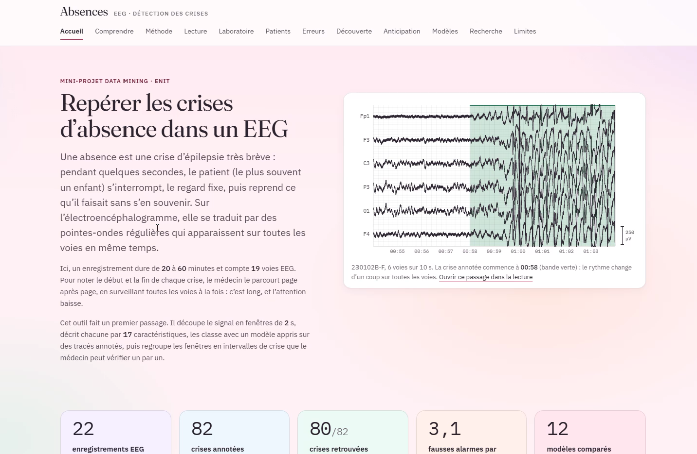<br><sub>Home page: an annotated absence on six channels and the headline figures.</sub></td>
    <td width="50%"><br><sub>Normal vs. seizure EEG excerpt and the 10-20 electrode map.</sub></td>
  </tr>
  <tr>
    <td><br><sub>Step-by-step walkthrough of the pipeline on a real excerpt (raw signal, filtering, windows, features, model, detections).</sub></td>
    <td>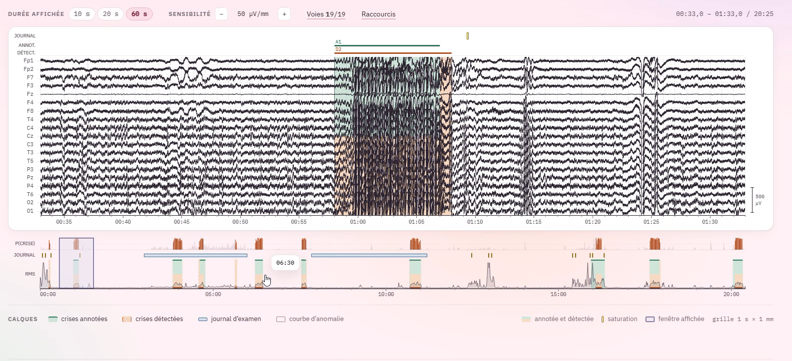<br><sub>19-channel viewer with annotated seizures, detected seizures and the probability track.</sub></td>
  </tr>
  <tr>
    <td>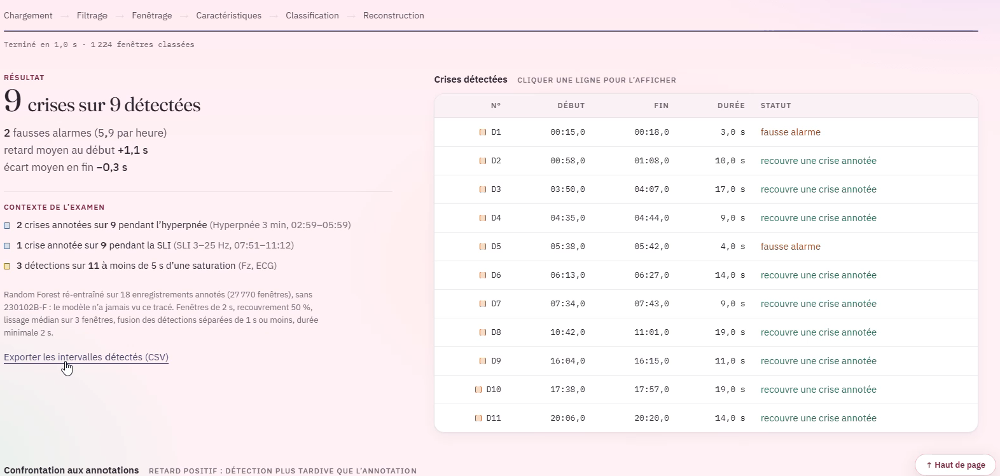<br><sub>Detection on one recording by a model trained without it: 9/9 seizures, 2 false alarms.</sub></td>
    <td>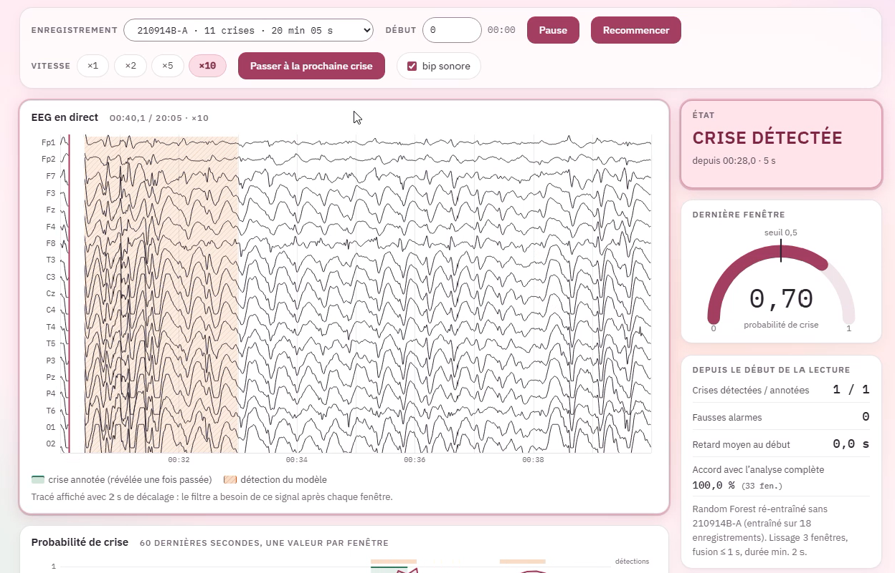<br><sub>Real-time replay: each new window goes through the same feature extraction, model and post-processing.</sub></td>
  </tr>
  <tr>
    <td>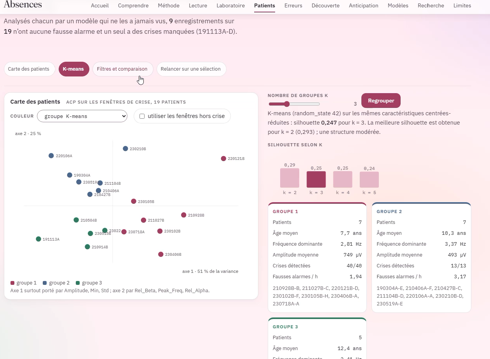<br><sub>PCA map of the recordings and K-means grouping on seizure-window features.</sub></td>
    <td>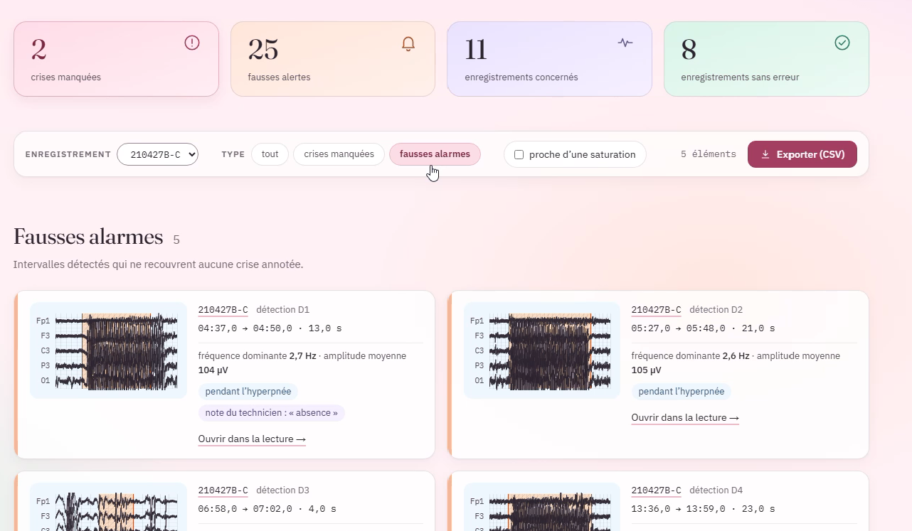<br><sub>Error analysis: missed seizures and false alarms with their EEG excerpt and exam context.</sub></td>
  </tr>
  <tr>
    <td>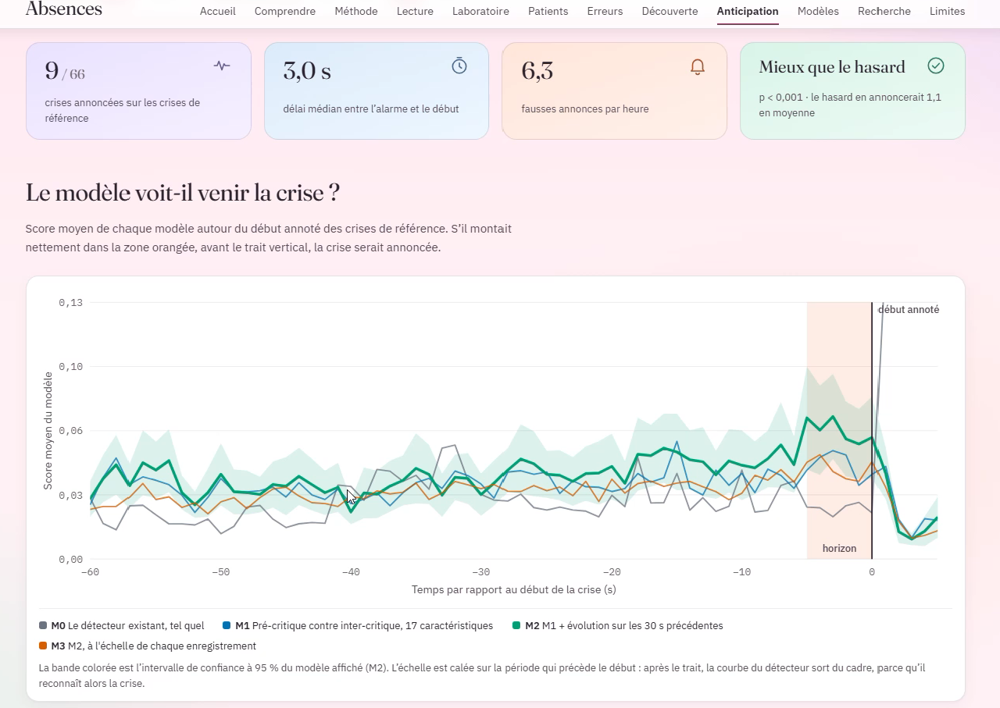<br><sub>Exploratory anticipation study: mean model score before annotated seizure onsets.</sub></td>
    <td>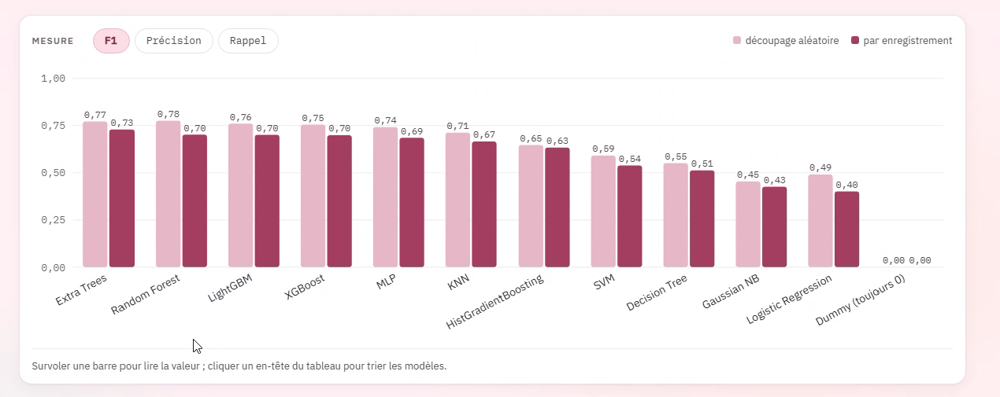<br><sub>F1 of the 12 models: random split vs. recording-wise validation.</sub></td>
  </tr>
  <tr>
    <td><br><sub>Model bench: choose a model, window length, feature subset and validation scheme.</sub></td>
    <td>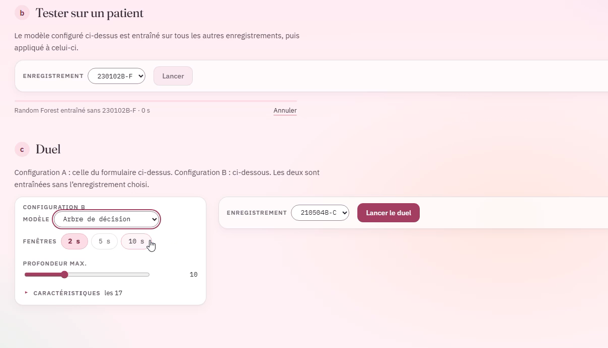<br><sub>Model bench: test on one recording, or compare two configurations on the same recording.</sub></td>
  </tr>
  <tr>
    <td>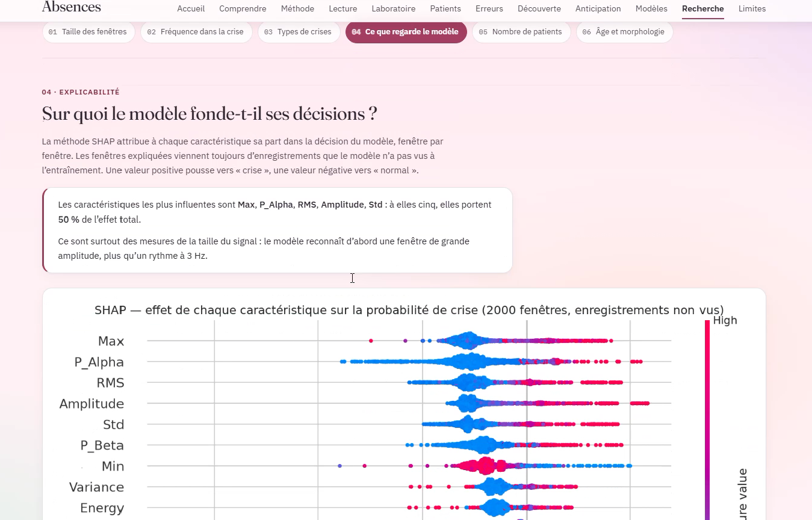<br><sub>SHAP summary on 2,000 windows from recordings not seen during training.</sub></td>
    <td><br><sub>Decision threshold vs. detected seizures and false alarms per hour.</sub></td>
  </tr>
  <tr>
    <td><br><sub>Stated limitations: small cohort, mostly children, untreated artefacts.</sub></td>
    <td><br><sub>Stress test: artefacts injected into an in-memory copy of a calm excerpt.</sub></td>
  </tr>
  <tr>
    <td>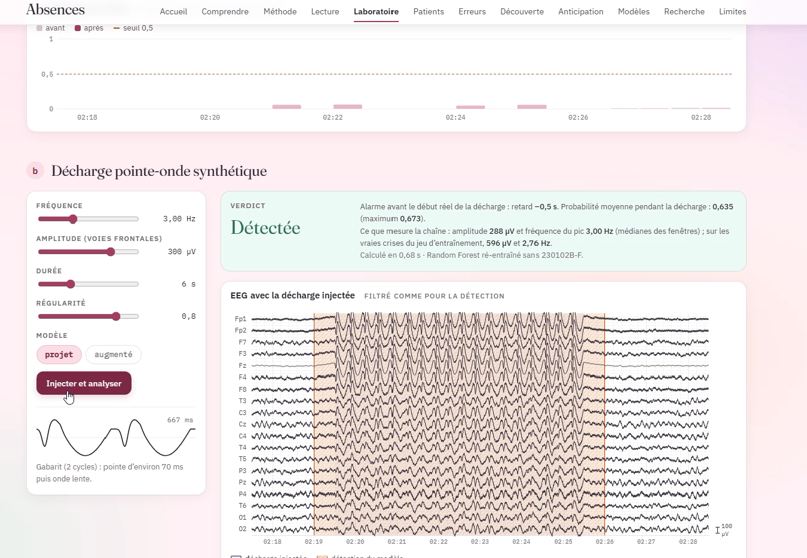<br><sub>A synthetic 3 Hz spike-and-wave discharge injected and passed through the full chain.</sub></td>
    <td>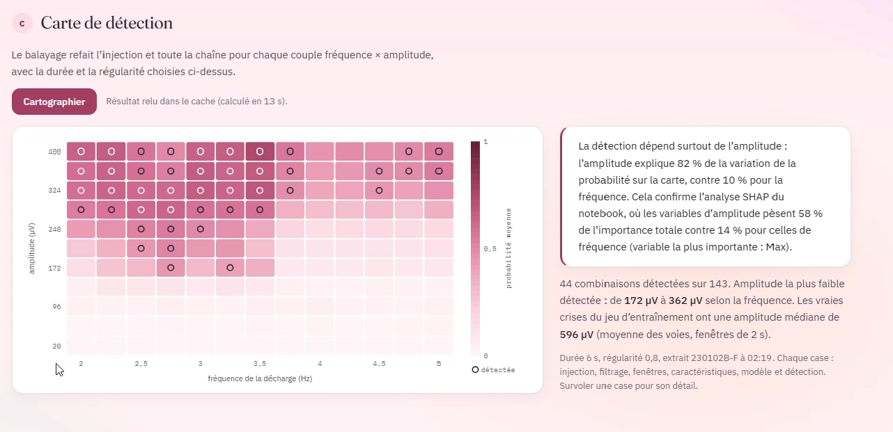<br><sub>Detection probability over a frequency × amplitude sweep of synthetic discharges.</sub></td>
  </tr>
  <tr>
    <td>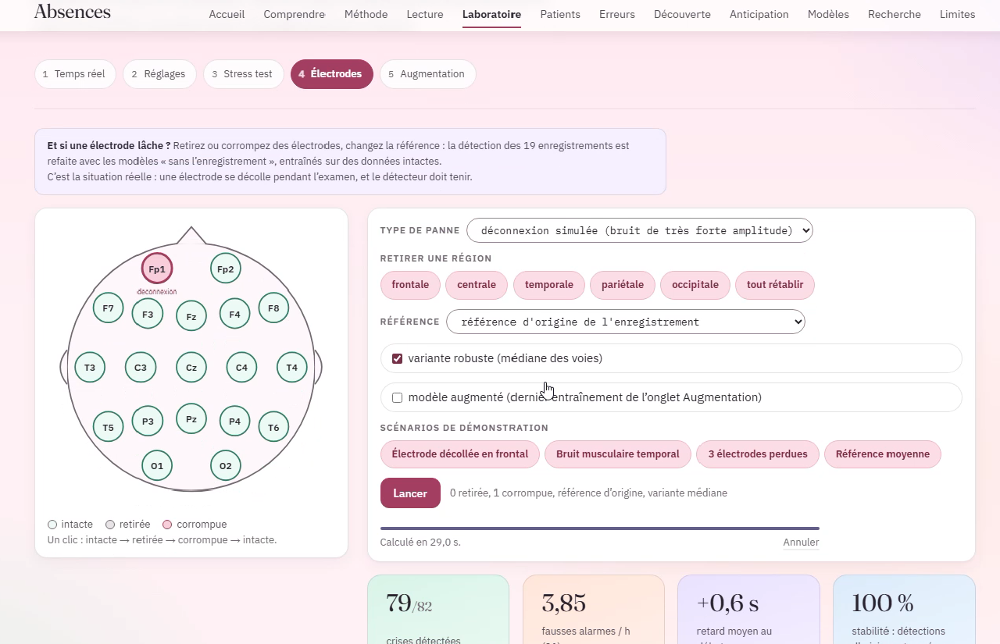<br><sub>Simulated electrode removal or corruption, with detection recomputed on the 19 recordings.</sub></td>
    <td><br><sub>Feature-level data augmentation of the training recordings, compared before and after.</sub></td>
  </tr>
</table>

## Engineering and implementation

### Pipeline architecture

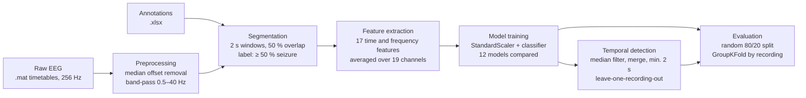

### Tech stack

The code is written in Python. Libraries actually imported:

| Library | Role |
|---|---|
| NumPy | signal arrays, sliding windows, FFT-based spectra |
| SciPy | `.mat` decoding (`scipy.io`), Butterworth filtering, median filtering, Welch PSD, Hilbert transform (`scipy.signal`), statistical tests (`scipy.stats`), hierarchical clustering |
| pandas | annotation tables, the window/feature dataset, result tables |
| openpyxl | reading the Excel annotation file (through pandas) |
| scikit-learn | classifiers, `Pipeline`, `StandardScaler`, `train_test_split`, `GroupKFold`, metrics, mutual information, K-means, PCA |
| XGBoost, LightGBM | gradient-boosting classifiers in the extended comparison |
| SHAP | model explainability |
| PyTorch | 1D convolutional autoencoder (exploratory study) |
| Matplotlib, seaborn | figures in the notebook |
| joblib | model serialization, parallel computation |
| FastAPI, Uvicorn | web application back end |
| HTML, CSS, JavaScript (no framework) | web application front end |

### Repository structure

```
.
├── EEG_Absence_Detection.ipynb          Main notebook: exploration, pipeline, models, evaluation, analyses
├── notebooks/
│   └── EEG_Absence_Detection_colab.ipynb  Google Colab version of the notebook
├── eeg_pipeline.py                      Pipeline functions extracted from the notebook (loading, annotations, filtering, segmentation, features, models, detection)
├── exam_journal.py                      Decoder for the *_0000h.mat exam logs
├── app.py                               FastAPI back end: recording catalogue, viewer, detection and API endpoints
├── analyses.py                          Signal measurements for the explanatory pages
├── methode_tour.py                      Data for the step-by-step method walkthrough
├── laboratoire.py                       Real-time replay, threshold tuning and stress tests
├── outils.py                            Model bench, patient tools and limitation demos (background jobs, cached)
├── augmentation.py                      Feature-level data augmentation and retraining
├── etude_autoencodeur.py                Autoencoder study: anomaly scoring and candidate unannotated discharges
├── etude_electrodes.py                  Robustness study: electrode removal, corruption, reference change
├── etudes_site.py                       API endpoints for the two studies above
├── recherche.py                         Read-only access to the notebook's research tables and figures
├── anticipation.py                      Read-only access to the anticipation study results
├── static/                              Front end (index.html, style.css, js/)
├── docs/screenshots/                    Screenshots used in this README
├── LANCER.md                            Detailed run and demo guide (French)
├── requirements.txt                     Python dependencies
├── LICENSE
└── README.md
```

These folders are created locally and are git-ignored: `data/` (dataset), `resultats/` and `resultats_local/` (notebook outputs), `.cache/` (application cache).

### Reproducibility

- **Python:** 3.10 or newer (`LANCER.md`). Dependencies are in `requirements.txt`.
- **Seeds:**
  - `random_state=42` for the train/test split, every classifier, K-means and PCA;
  - `random_state=0` for mutual information;
  - `random_state=1` for the internal validation split used in threshold tuning.
- **scikit-learn version:** the notebook notes that recording-wise F1 can differ in the fourth decimal between versions.

## Getting started

### Prerequisites

- Python 3.10 or newer
- The course dataset (not distributed with this repository)

### Installation

```bash
git clone https://github.com/chaimaelakremi/DataMining.git
cd DataMining
python -m venv .venv
source .venv/bin/activate        # Windows: .venv\Scripts\activate
pip install -r requirements.txt
```

### Data placement

Put the dataset in `data/` at the repository root:

```
data/
├── <ID>_0000d.mat          EEG signal (MATLAB timetable), one per recording
├── <ID>_0000h.mat          exam log, optional (used by the web app only)
└── Annotations MAJ.xlsx    seizure annotations (any *nnotation*.xlsx file name is accepted)
```

The notebook reads `DM_DATA` (default `data`) for the input folder and `DM_OUT` (default `resultats_local`) for its outputs.

### Run

1. **Notebook.** Open `EEG_Absence_Detection.ipynb` and run all cells. It builds `features_windows.csv`, trains and evaluates the models, and writes tables, figures and `best_model.joblib` to the output folder. On Google Colab, use `notebooks/EEG_Absence_Detection_colab.ipynb`: it mounts Google Drive and looks for a `DataMining` folder.
2. **Results for the web app.** The application reads four files from `resultats/`: `features_windows.csv`, `resultats_modeles.csv`, `detection_par_enregistrement.csv` and `best_model.joblib`. Either run the notebook with `DM_OUT=resultats`, or copy these files from `resultats_local/`.
3. **Web application.**
   ```bash
   uvicorn app:app --port 8000
   ```
   Then open <http://localhost:8000>. On the first start, the per-recording models and the cross-validation are computed in the background, which takes about 1 to 2 minutes according to `LANCER.md`. They are then cached in `.cache/`.

`LANCER.md` describes every page and demo.

## Limitations and future work

### Limitations

- **Small cohort:** 19 annotated recordings and 82 seizures. Only one adult patient and one recording with atypical absences, and the two seizures Random Forest misses belong to the adult. The data contain no patient identifier, so two recordings may come from the same person.
- **Optimistic random split:** overlapping windows from the same recording can fall on both sides of the split. Recording-wise validation lowers F1 for every model (Random Forest 0.7755 → 0.7020).
- **Channel averaging:** features are averaged over the 19 channels, which loses all spatial information. A large artefact on one channel can shift the average.
- **No artefact handling:** the notebook attributes many false positives to artefacts such as movements and eye blinks. Its SHAP analysis finds that false alarms have the same feature profile as true detections.
- **No hyperparameter search:** models use fixed hyperparameters.
- **Offline analysis:** detection runs on recorded files. The "real-time" mode of the web app replays a recording and is not connected to an acquisition device.
- **Small validation sample:** with 19 recordings, the statistical tests have limited power and the confidence intervals are wide. For example, the Random Forest window F1 bootstrap interval is 0.574 to 0.773.

### Future work

The first five directions come from the notebook; the last one is a deployment step:

- **Per-channel features** (19 × 17) with feature selection, and features such as spectral entropy, Hjorth parameters, line length, band ratios and inter-channel coherence.
- **Hyperparameter tuning** with `GridSearchCV` grouped by recording (`GroupKFold`).
- **Resampling** for the class imbalance (SMOTE or undersampling).
- **Deep learning** (1D CNN, LSTM) directly on the raw multichannel signal.
- **Post-processing** defined in seconds rather than in windows, so that longer windows become usable.
- **Clinical deployment directions:** more recordings, including adults and atypical absences; validation on an external cohort; and streaming detection on live acquisition.

## Author

**Chaima Elakremi**, Computer Science Engineering student, ENIT

- LinkedIn: https://www.linkedin.com/in/chaima-elakremi-748004332/
- GitHub: https://github.com/chaimaelakremi

## License

© 2026 Chaima Elakremi. All rights reserved. See [LICENSE](../LICENSE).
